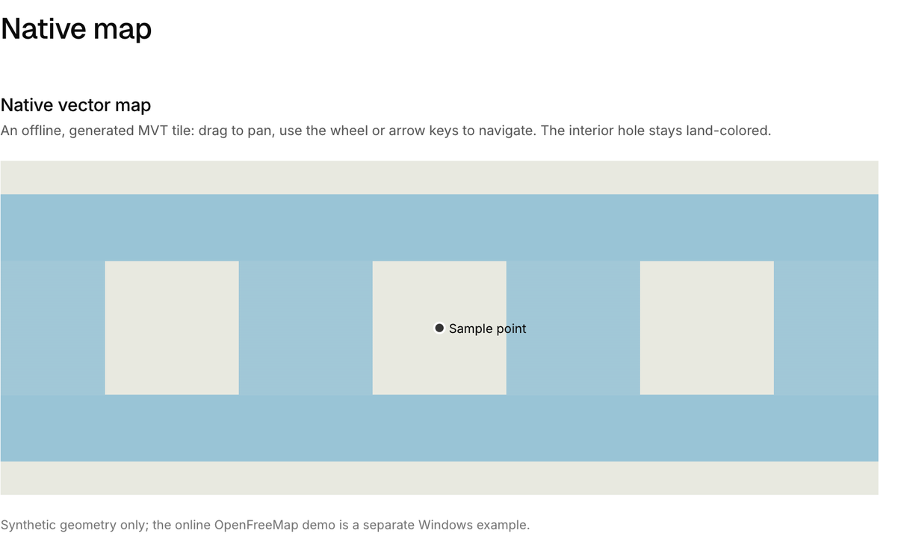

# Native vector map (experimental fork feature)

`cui_map_ex` draws a native, flat Web Mercator map from **uncompressed Mapbox Vector Tiles (MVT 2.1)**. It has no URL, provider, HTTP client, offline store or EXIF dependency. The caller owns the view and tile cache; CUI handles clipping, wheel and drag input, keyboard navigation and drawing. See the [offline gallery](../examples/gallery_more.c) and the Windows [live OpenFreeMap example](../examples/map_online_win32.cpp).




## Smallest host

```c
/* `cache_find` returns a decoded tile or NULL; `queue_visible_tile` never
   blocks and deduplicates outstanding requests. Host-owned view persists. */
cui_map_view view = {52.52, 13.405, 8};
/* In a frame, inside a layout scope: */
cui_map_result hit = cui_map(ui, "map", &view,
    .width = CUI_FILL, .height = CUI_PX(420),
    .lookup = cache_find, .request = queue_visible_tile, .tile_user = &cache,
    .markers = markers, .marker_count = marker_count, .max_zoom = 14);
if (hit.clicked_marker >= 0) select_marker(hit.clicked_marker);
```

Use `cui_mvt_tile_decode(data, length)` on uncompressed PBF data (a pure, bounded C99 function). It copies its input: release the downloaded bytes afterward, keep the returned tile until at least the end of the frame in which `lookup` returned it, then call `cui_mvt_tile_destroy`. Network/decompression, retry, request deduplication and cache eviction belong in the host. Keep marker labels and arrays valid through `cui_end_frame`; marker ids are nonnegative and `-1` means no hit. On a completed download, hand the parsed tile to the UI thread and request a redraw there. `lookup` and `request` execute synchronously during frame construction: **never wait for the network** in either callback. They are called only for visible tiles (with one extra tile of border while dragging).

Initial rendering supports theme-colored land and landcover, water polygons (including holes), transportation and waterway lines, a bounded budget of `place` names (up to 192 at z0–12) and, from z13, names from `transportation_name`, `poi`, `water_name`, named `waterway`, `park`, and `mountain_peak` features (up to 256 total, at most three per fixed 192-map-pixel world cell, with global collision checks), and supplied markers. At zoom 0–5 only motorway roads are drawn, trunk roads join at 6–8, primary roads at 9–10, secondary roads at 11–12, and from 13 all tile-provided road classes return. Waterway lines begin at zoom 10; water polygons remain visible at lower levels. Line widths still vary by zoom and class. Zoom targets remain integral (0–14 by default), but wheel/key zoom animates the displayed scale over about 200 ms, respecting reduced motion and retargeting immediately for consecutive input; `min_zoom` and `max_zoom` override them. Pointer drag pans, wheel zooms around the pointer; focus the map and use arrow keys or `+`/`-` to navigate. Hovering a marker uses the hand cursor and an opaque white border with a subtle size change; its normal border stays light in both themes. Tile requests and dragging are unaffected. During a drag on the vector fallback path, landcover detail, minor roads and waterways are temporarily omitted to reduce draw work; water, major roads and markers remain. Full detail returns on release. This does not alter which tiles are requested. All geometry and names originate in tile data; **this is not a full MapLibre style engine** (no expressions, imported fonts/glyphs, sprites, buildings, hill shading or language-specific label rules). The polygon scanline builder bounds *actual intersections*, not ring vertex counts: a valid long ring can have more than 2048 vertices without crossing any row 2048 times. This fixes a reproduced HTTP 200 OpenFreeMap `z6/53/29` tile previously mislabeled `invalid PBF`. Marker labels reserve space first. At z0–12 place labels keep their two tile/feature-order passes and two-per-cell limit; at z13–14 named features are considered by place, road, named water/landmark, then POI priority, with one accepted name per category/cell and room reserved for POIs. Line names use a representative long-segment midpoint, point names use their tile coordinate, and named polygon labels use a representative bounding-box center. Text stays horizontal and is not a full road-following style; the tile's `class` is used for road styling but is not used as a semantic city/town priority. World-anchored cells keep interior label quotas stable during pans, though real collisions or tiles entering/leaving view can still change which labels fit. Per recognized layer, feature/key/value metadata tables are sized to the actual encoded field counts, with checked allocation and an approximately 16 MiB per-layer maximum implied by the 2 MiB uncompressed input cap. This admits 33,766 `place` values in HTTP 200 `z2/1/0` without arbitrary metadata-count rejection; rendered features, geometry and polygon spans retain their independent safety limits, and unsupported or malformed tiles still return NULL. The example reports download failures separately and offers an explicit retry. The optional host-supplied `raster_lookup` supplies a prepainted tile texture while labels, marker collision and hit testing remain live; without a texture the widget draws vectors by default. Opt into `defer_vector_base` with a raster lookup to show cached previous-level images (or lightweight placeholders when no image exists) for decoded tiles still awaiting a baked image, keeping labels and markers dynamic; the Windows demo enables this while its raster baker is available. This avoids repeatedly software-rasterizing dense vectors during a new zoom's one-image-per-frame warmup. Other hosts retain immediate vector fallback. Missing tiles on zoom temporarily show only already-cached geographically matching tiles from the previous level (cropped/magnified when zooming in, mosaicked/shrunk when zooming out), then each target tile replaces its area as it arrives. Source lookups never request old-level data; if none exists or the cache cannot retain it, normal placeholders remain. Source labels are not reused, so they can appear later than the base image. `cui_map_tile_draw_base` draws one decoded tile's land/water/roads at logical 256×256 into a host offscreen CUI context, without caching or networking. The Windows demo renders at most one visible tile image per UI frame and keeps a separate 96 MiB raster cache (in addition to 192 MiB decoded tiles); it starts by following the OS light/dark theme, uses the CUI blue accent and includes a manual sun/moon toggle. Image entries now survive decoded-slot eviction and can be shown by themselves, so revisiting an already rendered area need not redraw dense roads. DPI changes invalidate images, and image entries evict independently under their own 96 MiB/384-entry limits. Markers and all tile-provided names remain live; names require decoded tile data and can be temporarily absent when it has been evicted. When decoded memory is at least 90% full, the demo does not repeatedly refetch an image-only tile just for labels. Cached tiles keep full base detail during dragging. An installed Microsoft YaHei or SimHei font is loaded for Chinese place names if available; no OS font is bundled.

Host photo or point-of-interest applications can supply generic `cui_map_marker` entries with `count > 1` to display a numbered cluster badge; badge hit testing uses the drawn radius. The host retains ownership of grouping and cluster membership. `cui_map_ex` returns a `projection` snapshot of the actual animated transform for this frame; after the call, `cui_map_project(&result.projection, lat, lon, &point)` projects a selected marker into window-logical coordinates (false if outside the map), allowing an application to anchor a live preview with `cui_popover_begin_at`. Recompute the projection every frame rather than caching screen positions; `cui_map_world_point` and `cui_map_geo_from_world` expose matching integer-zoom world coordinates and their inverse for stable host-side grouping and view fitting. No photo data or HTTP policy is added to the C99 core.

The Windows demo engine can also be compiled in an experimental host-adapter mode (`CUI_MAP_HOST_LIBRARY`) through `examples/map_host_win32.hpp`: Vivida's opt-in map build shares the same strict TileJSON/WinHTTP/decoded+disk/raster-cache code without pulling network dependencies into the C99 library. On startup the host uses strictly validated saved TileJSON immediately when present, then refreshes the provider's metadata in the background; a changed source invalidates old in-memory tiles. Without a saved source, one bounded metadata request ends in an explicit error/Retry instead of silently repeating. The host is paused when leaving map mode, does not retain photo data, and is destroyed after its CUI application context exits. This example-facing adapter is not a stable CUI core interface.

Map colors are application-owned, not supplied by OpenFreeMap. `cui_map_palette_default(CUI_THEME_LIGHT/DARK)` returns restrained CUI-compatible land, water, park, major/minor road, place-text, placeholder and marker-halo colors. Pass an optional palette through `cui_map_opts.palette` to customize a map; a NULL palette follows the current CUI context theme. To rasterize with custom colors, pass that same palette to `cui_map_tile_draw_base_styled`; the original `cui_map_tile_draw_base` retains default-theme behavior. Keep the host raster-image cache keyed to theme, DPI and baked base colors; the Windows demo invalidates only raster images on theme/palette change. Decoded and disk MVT bytes remain reusable. Marker fill and cluster badge text follow CUI's live accent and accent-foreground tokens, so set the CUI accent to customize their colors without baking them into tile images. Road levels, line widths and label density are unchanged by palette selection.

The Windows demo also persists successfully decoded HTTP 200 **uncompressed tile bytes** in `%LOCALAPPDATA%\\CUI\\MapTiles\\v1\\<SHA-256 source>\\<z>\\<x>\\<y>.pbf`. A visible request checks decoded memory first, then reads and validates that source's disk tile on a worker, then tries WinHTTP only on a miss or invalid file. The 2 MiB uncompressed limit also applies to files. Only the current viewport is requested; nothing is downloaded in bulk. Successful writes use an atomic temporary-file rename, and file reads explicitly update the last-write timestamp for future cache policy (Windows last-access timestamps are not trusted). A strictly validated last-good TileJSON is saved separately: a network/transport failure can use it for previously cached areas, with a `Retry online` action; an invalid HTTP 200 TileJSON never silently falls back. Source-template changes invalidate old in-memory tiles and images, and use a different disk directory. Disk errors do not stop drawing or network access. **There is currently no disk-size limit or automatic age-based eviction**: old versions remain and disk usage can grow. To clear it manually, close the demo and delete the `MapTiles` directory. The footer's `D/N` counters show admitted disk/network tiles. CUI's C99 map core does not access the filesystem.

For the Windows online example, build `map_online_win32` with `CUI_BUILD_EXAMPLES=ON` and a C++11 compiler, then run it. The example (not the C99 core) vendors MIT-licensed [json11](../examples/vendor/json11/README.md) to validate OpenFreeMap's `https://tiles.openfreemap.org/planet` TileJSON and its current versioned `.pbf` template before issuing requests. WinHTTP workers fetch tiles (at most four requests at a time), with a RAM-only decoded cache limited to 192 MiB and 384 entries, a separate eight-result backpressure queue, and a visible `OpenFreeMap © OpenMapTiles Data from OpenStreetMap` attribution. These are cache limits, not a whole-process memory limit. Queued viewport work is dropped when obsolete; workers retry transient failures at most three times with capped backoff and `Retry-After` for 429/503; completed results for obsolete requests are ignored. For a still-visible tile that exhausts these attempts, only transient network/429/5xx failures get up to two further requests after 15 and 45 seconds (respecting a longer `Retry-After`); HTTP 404, invalid PBF and tiles individually larger than the decoded-cache budget require manual Retry. A temporary cache-admission failure retries automatically after one second while the tile remains visible; the demo evicts already-presented tiles (preferring old zoom levels) before admitting completed downloads. The footer shows the current zoom `z` and one visible failed tile's `z/x/y` and HTTP/decoding reason. A stopped demo wakes waiting workers; active requests are bounded by WinHTTP timeouts rather than forcibly closed from the UI thread. The map widget shows subdued placeholders until tile delivery, and the demo reports errors and cache usage. The Windows demo defaults to CUI's software renderer, without changing CUI's global default: on one Berlin z8 screenshot-mode probe, OpenGL peaked at 687–803 MiB process RSS, versus 134–135 MiB with software and the same ~664k draw vertices. These machine-specific measurements are **not** a process-memory guarantee or a frame-time benchmark. Set `CUI_MAP_DEMO_GL=1` to opt back into normal renderer selection. It has no API key or offline bulk mode. Set `CUI_MAP_DEMO_OFFLINE=1` to exercise the TileJSON failure UI without fetching data, `CUI_MAP_DEMO_TILE_FAULT=404` (or `503`/`0` for transient HTTP/network failure) to exercise tile failures without tile requests (TileJSON still fetched), or `CUI_MAP_DEMO_SMALL=1` for a 460×360 window while checking responsive layout. Set `CUI_MAP_DEMO_BEIJING=1` for a z7 Beijing view to inspect Chinese labels. `CUI_MAP_DEMO_DISABLE_RASTER=1` allows a vector-only comparison. `CUI_MAP_DEMO_ZOOM_PROBE=1` (or `CUI_MAP_DEMO_ZOOM_OUT_PROBE=1`) plus `CUI_SCREENSHOT_FRAMES=450` simulates one zoom at frame 400; add `CUI_MAP_DEMO_ZOOM_FAULT=1` to fail only the new level and inspect retained source imagery without tile bulk requests. Setting `CUI_MAP_DEMO_BENCH=1` with `CUI_SCREENSHOT_FRAMES=850` simulates 100 pointer-drag frames for a local timing probe (not a user-interaction FPS guarantee). For opt-in performance diagnosis, launch the Windows demo with `CUI_APP_PROFILE=1`; it writes directly to `map-profile.log` in the process working directory, not to stderr (the Windows demo has no console). Set `CUI_APP_PROFILE_FILE` to an explicit path in an existing writable directory if preferred. The log is opened in append mode, starts with a confirmation line, flushes every 60 frames, and writes any partial sample on exit. Once per 60 rendered software frames, `cui profile` reports average/maximum `paint` (end-of-frame map geometry and labels), software `raster`, and `present` times plus framebuffer dimensions and damage area; `map profile` reports UI-thread result pumping, offscreen tile baking, and UI construction separately, with tile lookup and cached-raster hit counts. These stages exclude input waits/frame pacing, are not input-to-display latency, and do not claim a particular FPS. Profiling is disabled by default; GPU/GL frames do not have software-stage timings. The provider is external and has [usage terms](https://openfreemap.org/tos/) and no service-level guarantee; the CUI core does not take responsibility for connectivity, licensing or attribution. On other platforms, the reusable widget and offline gallery still compile; port the transport adapter to your platform as needed.
